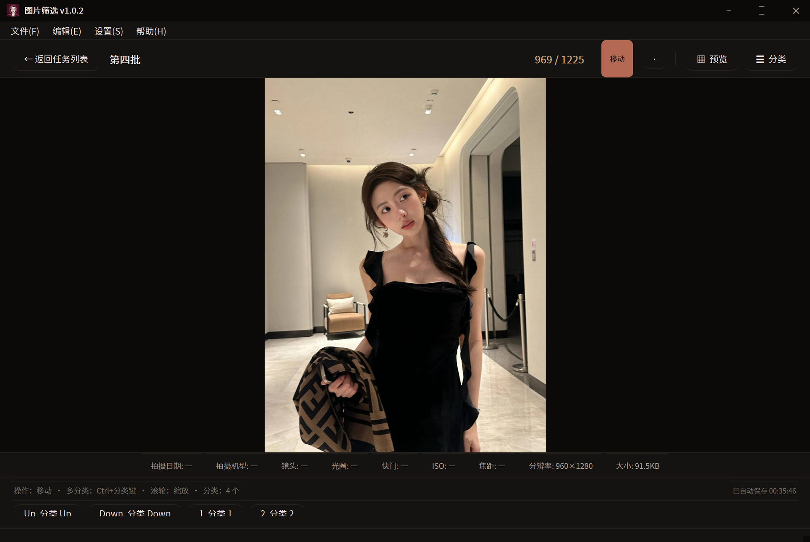
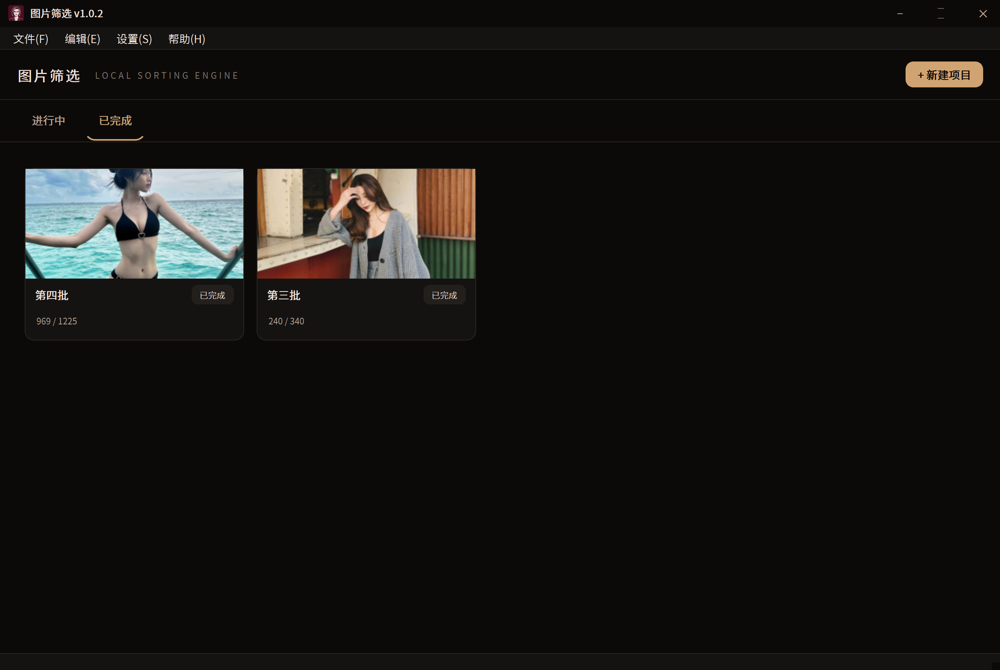

<div align="center">


# 图片筛选 · ImageSorter

**面向大量图片的键盘流筛选工具**

选目录 · 绑分类 · 按一下键 · 自动归档

[](https://github.com/BingJYYY/ImageSorter)
[](https://github.com/BingJYYY/ImageSorter/releases/latest)
[](https://www.python.org/)
[](https://doc.qt.io/qtforpython/)
[](https://www.microsoft.com/windows)
[](LICENSE)
[](https://github.com/BingJYYY/ImageSorter/stargazers)

[功能特性](#功能特性) · [界面预览](#界面预览) · [快速开始](#快速开始) · [快捷键](#快捷键) · [构建](#从源码构建) · [更新日志](#更新日志)

</div>

---

## 项目简介

ImageSorter 是一个 Windows 桌面图片筛选与归档工具。它把“看一张图、按一个键、归到一个文件夹”的动作压缩到一次按键，适合整理照片库、素材库、参考图、拍摄原片等大批量图片。

界面采用深色暖色调设计，支持一次性加载数千到上万张图片。所有分类、快捷键、进度和项目设置都按项目独立保存，关闭软件后可以继续上次的工作。

## 界面预览

<div align="center">

### 筛选主界面



### 项目列表



</div>

## 功能特性

| 能力 | 说明 |
| --- | --- |
| **键盘流筛选** | `← / →` 切图，分类快捷键直接复制或移动，操作后自动跳到下一张 |
| **项目化管理** | 每个项目独立的源目录、分类、排序、操作模式、进度和封面 |
| **自由分类** | 分类不再预设，按项目手动创建；每个分类包含名称、快捷键和目标文件夹 |
| **多分类强制复制** | 按住 `Ctrl` 再按分类键，可复制到多个分类且停留在当前图片 |
| **预览起始位置** | 缩略图墙分页异步加载，单击任意图片即可从该位置开始筛选 |
| **可撤销** | 复制、移动、删除都支持 `Ctrl+Z`；删除进入应用回收区，可恢复原文件 |
| **自动保存** | 每次操作立即写盘，定时兜底保存，无需手动点“保存” |
| **冲突检测** | 分类快捷键与系统动作冲突时会拦截，例如 `Ctrl+↑` 与放大 |
| **EXIF 信息条** | 拍摄日期、机型、镜头、光圈、快门、ISO、焦距、GPS、分辨率等字段可独立显隐 |
| **丰富排序** | 名称、拍摄日期、修改日期、创建日期、访问日期、类型、大小、分辨率、宽高比等 |
| **便携运行** | 单文件夹便携版，依赖、字体和图标全部内置，可直接复制到其他 Windows 电脑 |
| **无边框界面** | 自定义标题栏、原生边缘缩放、深色暖色调视觉 |

## 支持的图片格式

支持 Pillow 能解码的常见格式，以及可选的 HEIF / RAW 解码：

- **常用格式**：`JPG` `JPEG` `PNG` `BMP` `GIF` `WEBP` `TIF` `TIFF` `AVIF`
- **HEIF**：`HEIC` `HEIF`
- **RAW**：`CR2` `CR3` `NEF` `ARW` `DNG` `RAF` `ORF` `RW2` `PEF` `SRW` `X3F`

RAW 解码库默认按需加载。第一次遇到 RAW 图片时会显示加载提示，也可以在设置中改为启动时预加载。

## 快速开始

### 使用便携版

1. 打开 GitHub 的 [最新版本](https://github.com/BingJYYY/ImageSorter/releases/latest) 页面。
2. 下载 `ImageSort-v1.0.2-win64.zip`。
3. 解压到任意英文或中文路径。
4. 双击 `ImageSort.exe` 启动。

程序不写注册表，不需要安装。复制整个 `ImageSort` 文件夹即可迁移到另一台 Windows 电脑。

### 从源码运行

```bash
git clone https://github.com/BingJYYY/ImageSorter.git
cd ImageSorter

python -m venv .venv
.venv\Scripts\activate
pip install -r requirements.txt

python -m src.main
```

## 使用流程

1. 点击任务列表右上角的 **新建项目**。
2. 选择图片源目录，确认是否递归扫描子目录。
3. 点击 **+ 新建分类**，逐个设置分类名称、快捷键和目标文件夹。
4. 选择复制或移动，以及排序字段和升降序。
5. 点击 **创建并开始筛选**。
6. 在筛选界面按分类快捷键归档图片，按 `Ctrl+Z` 撤销，按空格打开预览。

## 快捷键

| 操作 | 默认按键 | 可修改 |
| --- | --- | :---: |
| 上一张 | `←` | 是 |
| 下一张 | `→` | 是 |
| 上一张（备用 / 跳 10 张） | `↑` | 是 |
| 下一张（备用 / 跳 10 张） | `↓` | 是 |
| 分类到目标文件夹 | 自定义分类键 | 是 |
| 多分类强制复制 | `Ctrl` + 分类键 | 是 |
| 撤销 | `Ctrl+Z` | 是 |
| 删除到应用回收区 | `Delete` | 是 |
| 打开预览 | `Space` | 是 |
| 放大 / 缩小 | `Ctrl+↑` / `Ctrl+↓` | 是 |
| 重置缩放 | `Ctrl+0` | 是 |
| 切换全屏 | `P` | 是 |
| 返回任务列表 | `Esc` | 是 |

所有系统动作键、分类键和修饰键都可以在设置中重新绑定。设置页支持双击或点右侧 `×` 解绑。

## 数据与便携性

```text
ImageSort/
├─ ImageSort.exe
└─ _internal/               运行时依赖

程序目录/
├─ settings.json            全局默认设置
├─ projects.json            项目索引
├─ projects/<项目ID>/
│  ├─ project.json          项目数据与筛选进度
│  ├─ project_settings.json 项目级设置覆盖
│  └─ log.csv               操作日志
├─ thumbcache/<项目ID>/     缩略图缓存
└─ trash/<项目ID>/          应用回收区
```

项目设置与项目数据分开存放，互不覆盖。缩略图单张默认不超过 200 KB，缓存上限可调。

## 从源码构建

### 环境

- Windows 10 / 11 x64
- Python 3.11
- PySide6 6.11
- PyInstaller 6.x

### 安装依赖

```bash
python -m venv .venv
.venv\Scripts\activate
pip install -r requirements.txt
```

### 打包

```bash
python -m PyInstaller --clean --noconfirm build.spec
```

输出目录：

```text
dist/ImageSort/
```

也可以双击 `build.bat` 或运行：

```powershell
.\build.ps1
```

## 项目结构

```text
src/
├─ app.py                 应用入口、主窗口、任务列表
├─ main.py                PyInstaller 启动引导与运行时修补
├─ core/
│  ├─ project.py          项目模型与持久化
│  ├─ settings_store.py   全局设置与项目设置
│  ├─ image_loader.py     格式扫描、EXIF、排序、解码
│  ├─ thumbnail.py        缩略图缓存
│  ├─ ops.py              复制、移动、删除
│  ├─ undo.py             撤销栈
│  └─ shortcut_conflicts.py 快捷键冲突检测
├─ ui/
│  ├─ task_list.py        项目列表
│  ├─ new_project.py      新建项目
│  ├─ filter_view.py      筛选主界面
│  ├─ settings_dialog.py  设置与项目设置
│  └─ widgets/            标题栏、分类编辑器、预览墙等
├─ assets/
│  ├─ fonts/              内置中文字体
│  └─ icons/              应用图标
└─ tools/
   └─ patch_qt6core.py    Qt6Core.dll 运行时兼容修补
```

## 更新日志

### v1.0.2

- 分类改为按项目手动创建，移除所有全局分类与目标预设。
- 项目设置与项目数据分离，分类、快捷键、封面修改可正确生效。
- 新增分类快捷键冲突检测，覆盖 `Ctrl+↑` 与放大等组合。
- `Delete` 删除移入应用回收区，`Ctrl+Z` 可恢复。
- 移除手动保存按钮，进度自动保存并显示保存时间。
- 设置、项目设置、预览、封面弹窗改为无边框样式。
- 预览缩略图分页异步加载，损坏缓存自动重建。
- 修复金色按钮文字不可见、新建项目页按钮被裁切的问题。
- 修复封面弹窗崩溃、项目设置分类不生效的问题。

### v1.0.1

- 新增任务列表、项目封面、分类面板、预览起始位置。
- 修复无边框窗口拖动、标签页高亮、快捷键解绑等问题。

## 致谢

- [PySide6](https://doc.qt.io/qtforpython/)：跨平台 Qt for Python 绑定
- [Pillow](https://python-pillow.org/)：图片解码与缩略图
- [rawpy](https://github.com/letmaik/rawpy)：RAW 解码
- [pillow-heif](https://github.com/bigcat88/pillow_heif)：HEIF / HEIC 支持
- [PyInstaller](https://pyinstaller.org/)：Windows 便携打包

## 许可证

本项目使用 [MIT License](LICENSE)。

---

<div align="center">

如果这个工具帮你节省了整理图片的时间，欢迎点一个 Star。

</div>
